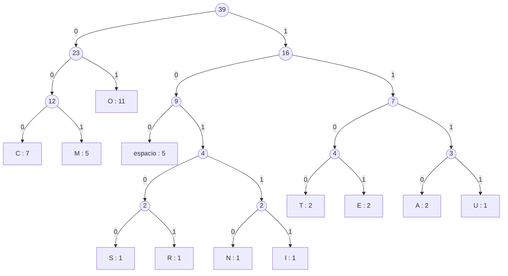

# Compresor de archivos con el algoritmo de Huffman (C++)

Trabajo práctico de **Algoritmos y Estructuras de Datos** (UTN), cátedra del Ing. Pablo Sznajdleder.

Es un programa de línea de comandos que **comprime y descomprime archivos de cualquier tipo** (texto, imágenes, binarios) con la codificación de Huffman. Está escrito en C++11 sobre la biblioteca de funciones y TADs de la cátedra (`List`, `Stack`, `HuffmanTree`, `BitWriter`, `BitReader`).

```text
$ ./huffman poema.txt
Comprimido:    poema.txt -> poema.txt.huf
$ ./huffman poema.txt.huf
Descomprimido: poema.txt.huf -> poema.txt
```

## Contenido

- [Cómo funciona la compresión de Huffman](#cómo-funciona-la-compresión-de-huffman)
- [Formato del archivo `.huf`](#formato-del-archivo-huf)
- [Estructura del repositorio](#estructura-del-repositorio)
- [Compilación](#compilación)
- [Uso](#uso)
- [Pruebas y ejemplos](#pruebas-y-ejemplos)
- [Correcciones respecto del código original](#correcciones-respecto-del-código-original)

## Cómo funciona la compresión de Huffman

En un archivo común cada byte ocupa 8 bits, aparezca una vez o mil. Huffman asigna a cada byte un **código de longitud variable**: los bytes que más se repiten reciben códigos cortos y los que menos se repiten, códigos largos. Ningún código es prefijo de otro (es un *código prefijo*), así que los bits de todos los códigos se pueden escribir uno detrás de otro, sin separadores, y la decodificación nunca es ambigua.

El recorrido completo se ve con el ejemplo clásico de la cátedra, [`examples/cocorito.txt`](examples/cocorito.txt):

```text
COMO COME COCORITO COME COMO COSMONAUTA        (39 bytes = 312 bits)
```

### 1. Tabla de frecuencias (`paso1`)

Se lee el archivo byte a byte y se cuenta cuántas veces aparece cada uno de los 256 valores posibles. La tabla es un array `HuffmanTreeTable tabla[256]` indexado por el propio byte, así que actualizar un contador es acceso directo: `tabla[c].cont++`.

| Byte        | `O` | `C` | `M` | espacio | `A` | `E` | `T` | `I` | `N` | `R` | `S` | `U` |
|-------------|----:|----:|----:|--------:|----:|----:|----:|----:|----:|----:|----:|----:|
| Ocurrencias |  11 |   7 |   5 |       5 |   2 |   2 |   2 |   1 |   1 |   1 |   1 |   1 |

### 2. Lista ordenada de hojas (`paso2`)

Por cada byte que aparece al menos una vez se crea un nodo hoja (`HuffmanTreeInfo`) y se arma una lista ordenada de menor a mayor ocurrencia. Cuando dos nodos tienen la misma ocurrencia se ordenan por el valor del byte: así el árbol resultante es siempre el mismo y el programa es determinístico.

### 3. Árbol de Huffman (`paso3`)

Mientras la lista tenga más de un elemento:

1. se sacan los dos primeros nodos (los de menor ocurrencia);
2. se crea un nodo interno con el primero como hijo **derecho** y el segundo como hijo **izquierdo**, cuya ocurrencia es la suma de ambas;
3. el nodo nuevo se inserta en la lista respetando el orden.

El nodo que queda al final es la **raíz**. Los nodos internos se numeran desde 256 en adelante, para que el desempate por valor nunca los confunda con un byte real. Para el ejemplo queda este árbol (en los nodos internos se ve la suma de ocurrencias):



### 4. Tabla de códigos (`cargarCodigoEnTabla`)

El código de cada byte es el camino desde la raíz hasta su hoja: **bajar a la izquierda agrega un `0` y bajar a la derecha agrega un `1`**. El TAD `HuffmanTree` recorre el árbol en profundidad con dos pilas (una de nodos y otra con el camino acumulado) y devuelve cada hoja junto con su código, que se guarda en `tabla[byte].code`.

| Byte    | Ocurrencias | Código  | Bits que aporta |
|---------|------------:|---------|----------------:|
| `O`     |          11 | `01`    |              22 |
| `C`     |           7 | `000`   |              21 |
| `M`     |           5 | `001`   |              15 |
| espacio |           5 | `100`   |              15 |
| `A`     |           2 | `1110`  |               8 |
| `E`     |           2 | `1101`  |               8 |
| `T`     |           2 | `1100`  |               8 |
| `U`     |           1 | `1111`  |               4 |
| `I`     |           1 | `10111` |               5 |
| `N`     |           1 | `10110` |               5 |
| `R`     |           1 | `10101` |               5 |
| `S`     |           1 | `10100` |               5 |
| **Total** |        39 |         |     **121 bits** |

Los mismos 39 bytes pasan de 312 bits a 121 bits (16 bytes): un 61 % menos de espacio para los datos.

### 5. Codificación de bits (`BitWriter`)

Se vuelve a leer el archivo desde el principio y por cada byte se escriben los bits de su código. El `BitWriter` acumula los bits y graba un byte en el archivo cada vez que junta 8:

```text
C    O   M    O   ␣    C    O   M    E
000  01  001  01  100  000  01  001  1101 ...
00001001 01100000 01001110 1...
  0x09     0x60     0x4E
```

Al terminar, `bitWriterFlush` completa con ceros el último byte. En el ejemplo, 121 bits ocupan 16 bytes y sobran 7 bits de relleno.

### 6. Descompresión

1. Se lee el encabezado y se **reconstruye el árbol**: por cada registro se sigue el camino que indica su código (0 = izquierda, 1 = derecha), creando los nodos que falten, y en el último bit se coloca la hoja con su byte.
2. Se lee el tamaño del archivo original.
3. Se leen los datos **bit a bit** partiendo de la raíz: cada bit indica hacia qué hijo bajar. Al llegar a una hoja se escribe su byte y se vuelve a la raíz.
4. El proceso termina después de escribir exactamente *tamaño original* bytes. Así los ceros de relleno del último byte no se interpretan como datos.

## Formato del archivo `.huf`

| Campo         | Tamaño           | Contenido                                                                              |
|---------------|------------------|----------------------------------------------------------------------------------------|
| `t`           | 1 byte           | Cantidad de hojas del árbol (1 a 255; el valor `0` representa 256).                   |
| `t` registros | variable         | Uno por cada byte presente en el archivo, en orden creciente:                          |
| ├ `c`         | 1 byte           | El byte.                                                                               |
| ├ `h`         | 1 byte           | Longitud de su código, en bits.                                                        |
| └ `m`         | ⌈h / 8⌉ bytes    | El código, alineado a la izquierda y completado con ceros.                             |
| tamaño        | 4 bytes          | Tamaño del archivo original (`unsigned int` en el orden de bytes del equipo: *little-endian* en x86/x64). |
| datos         | resto            | Los códigos de todos los bytes del archivo, concatenados y completados con ceros.      |

Para el ejemplo: 1 + 12 × 3 + 4 = **41 bytes de encabezado** + 16 bytes de datos = 57 bytes. En archivos muy chicos el encabezado pesa más que lo que se ahorra; la ganancia aparece en archivos medianos y grandes.

```text
0c | 20 03 80 | 41 04 e0 | 43 03 00 | ... | 27 00 00 00 | 09 60 4e c0 86 ...
 t    ' ' 3 100  'A' 4 1110 'C' 3 000         39 bytes        datos
```

Un archivo vacío se comprime en un `.huf` vacío.

## Estructura del repositorio

```text
huffman-cpp/
├── CMakeLists.txt            # Compilación con CMake + pruebas con CTest
├── Makefile                  # Compilación con GNU Make (g++ / clang++)
├── cmake/
│   └── roundtrip.cmake       # Prueba: comprimir -> descomprimir -> comparar
├── include/
│   ├── funciones/            # Biblioteca de la cátedra (funciones)
│   │   ├── arrays.hpp
│   │   ├── files.hpp         #   read<T>, write<T>, seek<T>, fileSize<T>
│   │   ├── lists.hpp         #   Node<T> y operaciones sobre listas enlazadas
│   │   └── strings.hpp
│   ├── tads/                 # Biblioteca de la cátedra (TADs)
│   │   ├── List.hpp
│   │   └── Stack.hpp
│   └── huffman/
│       ├── BitReader.hpp     # Lectura de un archivo bit a bit
│       ├── BitWriter.hpp     # Escritura de un archivo bit a bit
│       ├── Compresor.hpp     # paso1, paso2, paso3, cargarCodigoEnTabla, comprimir
│       ├── Descompresor.hpp  # armarArbolHuffman, descomprimir
│       └── HuffmanTree.hpp   # Nodo del árbol y TAD iterador HuffmanTree
├── src/
│   ├── main.cpp              # Punto de entrada (línea de comandos)
│   ├── funciones/
│   │   └── strings.cpp
│   └── huffman/
│       ├── BitReader.cpp
│       ├── BitWriter.cpp
│       ├── Compresor.cpp
│       ├── Descompresor.cpp
│       └── HuffmanTree.cpp
├── examples/                 # Archivos de prueba del TP
└── tests/
    └── casos_borde/          # Archivo vacío, 1 byte, un solo símbolo, los 256 bytes
```

## Compilación

Requisitos: un compilador de C++11 (g++, clang++ o MSVC) y, opcionalmente, CMake 3.15 o superior o GNU Make.

### Con CMake (Linux, macOS y Windows)

```bash
cmake -S . -B build
cmake --build build --config Release
```

El ejecutable queda en `build/huffman` (con Visual Studio, en `build/Release/huffman.exe`).

### Con Make (Linux, macOS, MSYS2)

```bash
make
```

El ejecutable queda en `build/huffman`. `make DEBUG=1` compila con símbolos de depuración.

### Directamente con g++

```bash
g++ -std=c++11 -O2 -Iinclude src/*.cpp src/*/*.cpp -o huffman
```

## Uso

```text
huffman <archivo> [<archivo> ...]
```

El programa decide qué hacer según la extensión de cada archivo:

| Archivo recibido          | Acción         | Resultado                                         |
|---------------------------|----------------|---------------------------------------------------|
| No termina en `.huf`      | Comprime       | Genera `<archivo>.huf` al lado del original       |
| Termina en `.huf`         | Descomprime    | Restaura `<archivo>` sin la extensión `.huf`      |

### Comprimir

```bash
./build/huffman examples/poema.txt
```

Genera `examples/poema.txt.huf`. El archivo original no se modifica.

### Descomprimir

```bash
./build/huffman examples/poema.txt.huf
```

Restaura `examples/poema.txt`. **Si ese archivo ya existe, se sobrescribe.** Para comprobar que la restauración es exacta sin pisar el original:

```bash
cp examples/poema.txt /tmp/poema.txt
./build/huffman /tmp/poema.txt            # genera /tmp/poema.txt.huf
mv /tmp/poema.txt /tmp/poema.original.txt
./build/huffman /tmp/poema.txt.huf        # restaura /tmp/poema.txt
cmp /tmp/poema.txt /tmp/poema.original.txt && echo "Idénticos"
```

En Windows, `fc /b archivo1 archivo2` reemplaza a `cmp`.

Se pueden indicar varios archivos en la misma llamada (`./build/huffman a.txt b.bmp c.txt.huf`). El programa termina con código 0 si todos se procesaron bien y con 1 si alguno no se pudo abrir.

## Pruebas y ejemplos

Las pruebas comprimen cada archivo de `examples/` y `tests/casos_borde/`, lo descomprimen y verifican que el resultado sea idéntico byte a byte al original:

```bash
ctest --test-dir build --output-on-failure    # con CMake
make test                                     # con Make
```

Resultados con los archivos de ejemplo del TP (porcentaje = tamaño comprimido / tamaño original):

| Archivo             | Original (bytes) | Comprimido (bytes) |    % | Comentario                                       |
|---------------------|-----------------:|-------------------:|-----:|--------------------------------------------------|
| `Hola.bmp`          |          373 371 |             81 538 |  22 % | Imagen sin comprimir con pocos colores           |
| `Chau.bmp`          |        2 239 545 |          1 386 116 |  62 % | Imagen sin comprimir                             |
| `poema.txt`         |              437 |                403 |  92 % | Texto corto: el encabezado se lleva la ganancia  |
| `foto.bmp`          |           24 613 |             25 340 | 103 % | Bytes casi equiprobables                         |
| `FotoFinal.jpg`     |          203 405 |            204 125 | 100 % | JPEG ya está comprimido (usa Huffman internamente) |
| `perro.jpg`         |           87 282 |             88 000 | 101 % | Ídem                                             |
| `cocorito.txt`      |               39 |                 57 | 146 % | Ejemplo de la cátedra: 41 bytes son encabezado   |
| `pruebaHuffman.txt` |               14 |                 27 | 193 % | Archivo mínimo                                   |

Huffman sólo gana espacio cuando los bytes **no** aparecen con la misma frecuencia. Un archivo ya comprimido (JPEG, ZIP, MP3) tiene bytes casi uniformes y no se puede reducir más con esta técnica.

## Correcciones respecto del código original

El código se reorganizó en módulos (`.hpp` con las declaraciones y `.cpp` con las implementaciones) sin cambiar el algoritmo ni el formato del `.huf`. Además se corrigieron estos errores:

| Dónde | Problema | Corrección |
|-------|----------|------------|
| `main` | El ciclo comprimía 6 veces `argv[1]` y no validaba `argc` (`arcg`). | Procesa cada argumento, muestra un mensaje de uso y devuelve un código de error. |
| `paso1` | `while(!feof(f))` leía dentro del ciclo: al llegar al final contaba un byte inexistente, porque `feof` recién es verdadero después de una lectura fallida. | Se lee un byte antes del ciclo y el siguiente al final de cada vuelta, como ya hacía `comprimirArchivoOriginal`. |
| Nombres de archivo | `char newName[length(nombre)]` no dejaba lugar para el `'\0'`: `strcpy` escribía fuera del array. Además los arrays de largo variable no son C++ estándar. | Se usa `string::c_str()`. |
| Descompresión | Se decodificaba hasta el fin del archivo, incluidos los ceros de relleno. Con `cocorito.txt` el relleno `0000000` contiene dos veces el código de `C` (`000`) y el archivo restaurado terminaba en `...COSMONAUTACC`. | Se restauran exactamente *tamaño original* bytes. El tamaño ya se grababa en el `.huf`, pero no se usaba. |
| `bytesToChar` | No reiniciaba el acumulador cada 8 bits: funcionaba de casualidad con códigos cortos y desbordaba el `int` con códigos de más de 24 bits. `m[10]` limitaba los códigos a 80 bits. | Se reinicia el acumulador y `m` tiene 32 bytes (el código más largo posible tiene 255 bits). |
| Un solo byte distinto | La raíz del árbol era una hoja con código vacío: no se escribía ningún bit y la descompresión fallaba. | Se le asigna el código `0`. |
| Archivo vacío | Se accedía a una lista vacía (puntero nulo). | Genera un `.huf` vacío, que se descomprime en un archivo vacío. |
| Biblioteca de listas | `size()` contaba un nodo de menos y fallaba con la lista vacía (`paso3` dependía de ese error). `addFirst` copiaba la lista entera en cada `push`. `listOrderedInsert` devolvía un puntero a una variable local. | Se corrigieron las funciones y `paso3` usa `listSize(...) > 1`. |
| Memoria | `huffmanTreeNext` hacía dos `new` que nunca se usaban, `paso2`/`paso3` perdían cada nodo temporal y el árbol nunca se liberaba. | Se eliminaron las reservas innecesarias y se agregó `huffmanTreeFree`. |
| Archivos | El original se abría en modo `"r+b"` (requiere permiso de escritura) y no se verificaba que `fopen` funcionara. `read<T>` devolvía basura al llegar al final del archivo. | Se abre con `"rb"`, se informa si un archivo no se puede abrir y `read<T>` devuelve `T()` en el final del archivo. |
| Código muerto | `intToBin`, `sizeOriginalToChar`, `descomprimirSizeOriginal`, `Progress.hpp` (dependía de `windows.h`) y TADs no usados (`Map`, `Queue`, `Coll`, `Array`). | Se quitaron, así que el proyecto compila en Linux, macOS y Windows. |

También se reemplazaron los comentarios pendientes por explicaciones y se corrigieron nombres con errores de tipeo (`restaurarArchivoOrignal`, `fDescomprimdo`).

El código original se perdió durante un proceso de migración de archivos, por lo que solo se cuenta con esta versión corregida.

## Créditos

- Biblioteca de funciones y TADs (`List`, `Stack`, `HuffmanTree`, `BitWriter`, `BitReader`, `files.hpp`): cátedra de Algoritmos y Estructuras de Datos, UTN FRBA.
- Enunciado del trabajo práctico: Ing. Pablo Sznajdleder.
- Integrantes del Grupo:
    - Barbieri, Tomás Iván
    - Benitez, Camila Nahir
    - Hygonenq, Federico
    - MagyarSzapari
    - Vazquez, Lucas Manuel
